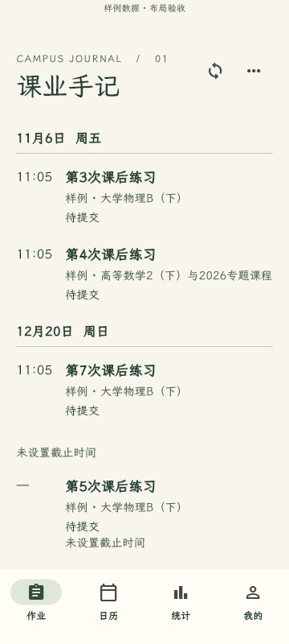
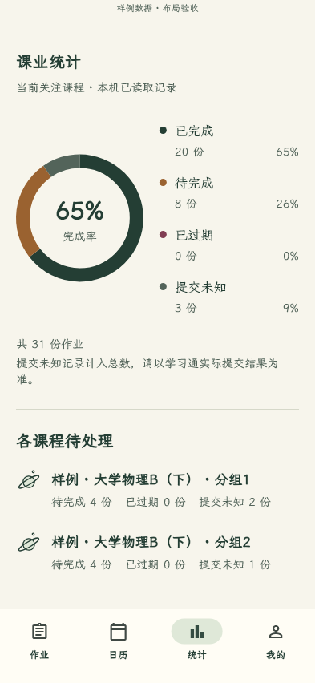
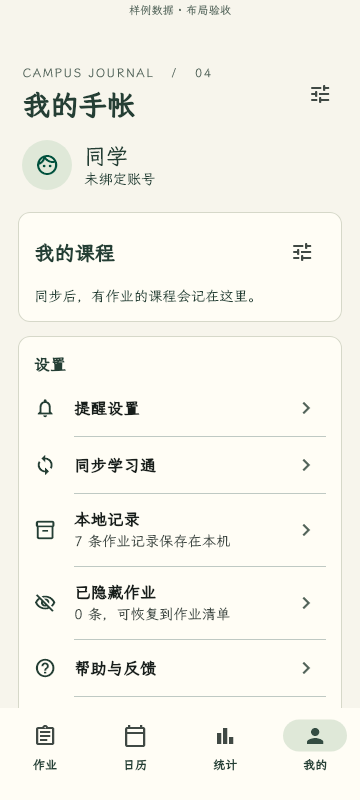

# 学习通课业手记

一款手账风格的学习通作业管理 Android 应用。把课程、作业、截止时间和本地提醒整理在一本暖纸色的手记里，使用霞鹜文楷、无框时间轴和课程手绘图案。

[](https://github.com/arrry-07/chaoxing-journal/actions/workflows/flutter-checks.yml)
[](https://github.com/arrry-07/chaoxing-journal/releases/latest)
[](LICENSE)

**[下载 Android 体验版](https://github.com/arrry-07/chaoxing-journal/releases/latest)** · [安装与使用](docs/guides/安装与使用.md) · [反馈问题](https://github.com/arrry-07/chaoxing-journal/issues/new/choose) · [开发与贡献](CONTRIBUTING.md)

这是社区维护的第三方工具，与学习通官方没有隶属关系。作业作答与提交仍需在学习通完成。

## 功能

- **作业时间轴**：按北京时间显示日期与截止时刻，未逾期在前、逾期在后；不确定的日期或提交状态单独保留，不靠猜测补全。
- **搜索与期限筛选**：按作业标题或课程搜索，按 7 天、30 天、逾期、期限待确认或无截止筛选，并显示同步新鲜度；期限未知项不会被误当普通截止。
- **明确的同步反馈**：手动刷新有即时进度，完成、部分成功和失败分别提示；支持登录失效和安全验证后的恢复。
- **截止日历与本地提醒**：选择提前提醒时间，查看已确认截止日期的作业；桌面小组件显示最近保存的本机快照。
- **每日计划与个人记录**：安排作业日期和预计耗时，保存个人清单、备注、HTTPS资料链接及本机文件关联；规则规划可按预算预览候选，用户填写耗时并确认后才保存，个人完成与学习通提交状态分开。
- **提醒体检与每日摘要**：核对系统权限与通知数量，主动发送测试通知；可选的每日摘要默认关闭。
- **个人待办、考试与学期快照**：手动安排日程并接入日历与提醒，命名保存只读学期快照，回看作业、个人笔记和填写过的预计耗时。
- **课程与本机记录**：按课程及班级管理关注范围，查看全部课程与本地记录，隐藏和恢复作业。隐藏不等于提交。
- **完成率统计**：区分已完成、待完成、已过期和提交未知，保留课程手绘标记。

## 界面预览

以下截图由当前界面实际渲染，使用**合成样例数据**，不包含真实账号资料。

| 首页 | 统计 | 我的 |
| --- | --- | --- |
|  |  |  |

## 下载安装

当前公开版本为 **1.6.3（48）**；冻结草稿为 **1.6.4（49）**，尚无公开下载资产。后续真实设备验收又修复了输入反馈和已投递提醒回收等问题，当前源码验收增量超出该Tag，草稿暂缓公开，详见[真实单账号验收](docs/reviews/2026-11-09-真实单账号全面验收.md)。当前准备 **1.6.5（50）未发布候选**，没有公开下载链接；不替换旧Tag或草稿附件。支持 Android **8.0 及以上**，适用于 **ARM64 / x86_64**。

1. 从 [Releases](https://github.com/arrry-07/chaoxing-journal/releases/latest) 下载 `chaoxing-journal-1.6.3.apk` 和 `SHA256SUMS.txt`。
2. 核对文件的 SHA-256，然后按 Android 提示安装。具体校验命令见[安装指南](docs/guides/安装与使用.md#下载安装)。
3. 使用自己的学习通账号登录，点击首页右上角刷新；遇到验证提示时按应用指引处理。

体验包使用 `com.example.studyassistant.journal` 包名和维护者提供的体验签名。**升级直接覆盖安装，勿先卸载**；自行编译的 Debug 包默认使用本机 debug keystore，不能保证与体验包签名相同。支持在“我的 → 加密备份与恢复”导出本机课业备份；不导出登录凭据、签名链接和说明正文。1.6.3 继续沿用既有体验身份，只通过 GitHub Release 更新。

## 使用边界

- 登录与同步直接连接学习通，账号凭据保存在本机安全存储；课程作业记录保存在本机偏好文件。头像、GitHub 链接与已配置的更新检查也可能联网，详见[隐私与安全](docs/guides/隐私与安全.md)。
- 读取失败不代表没有作业，“提交未知”不代表未交或过期。重要截止和提交结果请核对学习通原页面。
- 自动同步依赖应用进程与恢复运行时的检查，不能保证被系统关闭后仍持续联网。通知还受权限、省电和厂商后台限制影响。
- “我的 → 检查更新”直接读取本仓库最新正式 Release，支持应用内下载与后台收起；安装前校验 SHA-256、包名、签名和版本，再由 Android 确认安装。首次安装请从 Releases 下载；旧版未接通的更新入口不会因仓库公开而自动修复。
- Android 是当前交付目标；仓库保留 iOS 工程，但尚未完成 iOS 构建验收。

## 本地开发

主应用位于 [`study_assistant-1.1.0/local_app`](study_assistant-1.1.0/local_app)。当前验证环境为 Flutter **3.44.9** / Dart **3.12.2**、JDK **17**、Android SDK **36**。

```sh
git clone https://github.com/arrry-07/chaoxing-journal.git
cd chaoxing-journal/study_assistant-1.1.0/local_app
flutter pub get --enforce-lockfile
flutter analyze --no-pub
flutter test --no-pub
flutter build apk --debug --no-pub --target-platform android-arm64,android-x64
```

依赖由 `pubspec.lock` 固定；SDK 路径与签名配置由开发者在本机准备。正式 release 构建需要私有签名配置，不提供默认正式密钥。环境、目录职责、参考测试和提交要求见[开发指南](docs/guides/开发与贡献.md)。

## 仓库结构

```text
.github/                       CI、Issue 表单与 PR 模板
study_assistant-1.1.0/local_app/ Flutter 应用、Android/iOS 工程与测试
references/xuexitong-cli/       固定版本的只读接口参考
docs/guides/                   使用、开发、隐私指南
docs/images/                   合成数据的界面预览
docs/archive/                  历史验收与实施资料
```

当前验证范围见[验收记录](docs/验收.md)，全部文档入口见[文档索引](docs/README.md)。本地安装包、设备截图、工具输出与签名材料不进入 Git 源码历史。

## 反馈与贡献

欢迎通过 [Issues](https://github.com/arrry-07/chaoxing-journal/issues/new/choose) 提交可复现的问题或功能建议。请提供应用版本、Android 版本和操作步骤，先去除账号、Cookie、个人资料及截图中的身份信息。

开发贡献请阅读 [CONTRIBUTING.md](CONTRIBUTING.md)，安全问题请按 [SECURITY.md](SECURITY.md) 私下报告。

## 来源与许可

- 应用基于 [mshzy/study_assistant](https://github.com/mshzy/study_assistant) v1.1.0 二次开发，保留 HY 的原始 [MIT 许可证](LICENSE)。
- 学习通接口查询参考 [DanMo661/xuexitong-cli](https://github.com/DanMo661/xuexitong-cli/commit/74b843ad4a3439a6ee5ba33f6a3288d9be6ed990)，本仓库保留[参考代码与 MIT 许可](references/xuexitong-cli/LICENSE)。
- 字体使用 [LXGW WenKai Screen](https://github.com/lxgw/LxgwWenKai-Screen)，遵循 [SIL OFL 1.1](study_assistant-1.1.0/local_app/assets/type/OFL-WenKai.txt)，保留[字体来源与校验信息](study_assistant-1.1.0/local_app/assets/type/README.md)。
- 测试专用依赖 `cryptography` 2.9.0 来自 [pub.dev](https://pub.dev/packages/cryptography/versions/2.9.0)，遵循 Apache License 2.0；仅用于在 Flutter 测试进程验证与 Android `BackupCrypto` 兼容的 PBKDF2/AES-GCM 往返，不进入应用运行依赖。

本仓库的 MIT 许可不替代第三方组件各自的许可。Dart 依赖及版本见 [pubspec.yaml](study_assistant-1.1.0/local_app/pubspec.yaml) 与 [pubspec.lock](study_assistant-1.1.0/local_app/pubspec.lock)。
