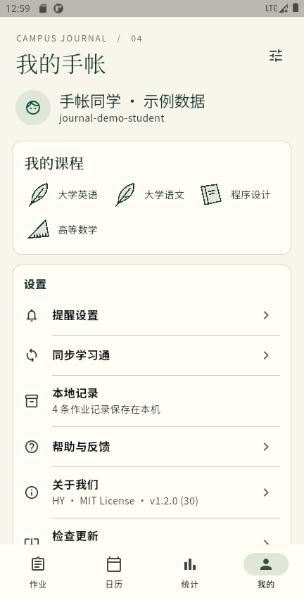

# 学习通课业手记

专门服务学习通的 Android 作业手帐。暖纸底色、深墨正文、宋体短标题；优先展示下一份待交作业，按日期和准确时间排列。

基于 [mshzy/study_assistant](https://github.com/mshzy/study_assistant) 二次开发，保留原项目 MIT 版权声明。接口查询参考 [DanMo661/xuexitong-cli](https://github.com/DanMo661/xuexitong-cli)。

## 安装与使用

本轮本地交付 `学习通课业手记-1.2.4-deadline34.apk`，未上传 APK。历史发行版见 [Releases](https://github.com/arrry-07/chaoxing-journal/releases)，仓库为私有，需访问权限。Android 8.0 及以上，ARM64 / x86_64。

此体验包包名 `com.example.studyassistant.journal`、版本 `1.2.4+34`。与此前《课业手记》体验包保持同包名、同签名，可覆盖安装；与上游原版应用并行。不要卸载上一体验版后再装，否则会丢失本机数据。体验包采用本机调试签名，后续覆盖包需使用同一密钥；密钥不上传仓库。

登录学习通后下拉首页或点击刷新。成功读取到已提交/待批阅状态后，作业退出待交清单，取消后续提醒并更新小组件。退回重做会重新进入待交。未识别的状态保持“提交状态未知”，读取失败保留旧数据。手动操作“仅在本机隐藏”不会向学习通提交作业。

**同步不是推送实时同步**：手动刷新会请求学习通；返回前台或 App 运行期间的定时器按设置间隔尝试同步。Android 杀进程或冻结后台后，无法保证继续查询。已安排的系统通知与后台联网查询是两回事，锁屏/省电/自启动行为需在手机上确认。

## 预览

截图说明、测试结果与限制见 [验收记录](docs/验收记录.md)。所有展示数据均为测试样例，不包含真实学校账号。

| 首页 | 我的 |
|---|---|
|  |  |

## 开发

主应用位于 `study_assistant-1.1.0/local_app`。本轮使用 Flutter 3.44.9 / Dart 3.12.2 / JDK 17 / Android SDK 36 验证。

```sh
cd study_assistant-1.1.0/local_app
flutter pub get
flutter test
flutter analyze
flutter build apk --debug --target-platform android-arm64,android-x64
```

`pubspec.lock` 固定依赖。Android SDK、Flutter SDK、Gradle 缓存、`local.properties`、账号会话、签名密钥不提交。下载参考代码不表示 Android App 会启动 Python；Flutter 已实现对应的逐课程/逐班级查询逻辑。

## 目录与来源

- `study_assistant-1.1.0/local_app`：Flutter / Android / iOS 源码、资源与测试。交付目标为 Android，iOS 尚未构建验收。
- `references/xuexitong-cli`：固定版本的只读接口参考与核心测试。
- `docs`：需求验收表、测试证据、来源和许可证说明。
- `study_assistant-1.1.0/local_app/tool/android_upgrade_probe`：仅供测试模拟器的旧数据迁移夹具，不打入正式应用；不得用于已有真实账号数据的设备。

详见 [第三方来源](docs/第三方来源.md)、[MIT 许可证](LICENSE)。


## 体验改进实施（2026-11-04）

针对正式作业来源、登录与同步反馈、个人页交互、截止日历及应用内覆盖更新的13项反馈，已整理[具体执行方案](docs/superpowers/plans/2026-11-04-体验与作业数据修复方案.md)和[逐项验收清单](docs/体验问题验收清单.md)。本次已实施来源分类、非阻塞登录、同步摘要、首页分组、截止日历、个人页内部页面及可配置更新流程。自动验证与真机待验项见[本次实施记录](docs/体验修复实施记录.md)，公开更新渠道及覆盖安装见[分发说明](docs/更新分发与覆盖安装.md)。历史版本说明与测试结果仍按原记录解释；本次未发布正式包。


## 本轮 MuMu 实测（2026-11-04）

最新证据见 [本轮验收](docs/2026-11-04-本轮验收.md)：独立登录和新版正式作业接口在 MuMu 完成40门课程读取，取得31份正式作业。旧页面签名解析无法处理 fanyav3，新版还需要正确处理服务端9010人工验证。应用内更新的检查、下载、校验和安装器流程已有实现与测试，但在线分发地址尚缺，不视为真实在线更新验收完成。


## 首页与统计UI改版（1.2.3 / 33）

首页统一列表宽度与分组、区分无截止和待确认；统计使用三类互斥的实心饼图与稳定课程身份。新测试包保留原测试签名，可覆盖32版。最新验证和截图见 [UI改版验收](docs/2026-11-04-首页与统计UI改版验收.md)。

## 截止时间修复（1.2.4 / 34）

修正新版列表零值被误认作无截止的问题，访问原作业详情，并用同一份作业的绝对开始时间核对年份。MuMu真实同步11份待交中恢复10份精确截止；1份尚未开放，保留待确认。失败保留列表与旧日期，不猜年份。方案、证据和安装说明见 [截止时间验收](docs/2026-11-04-截止时间读取验收.md)。
