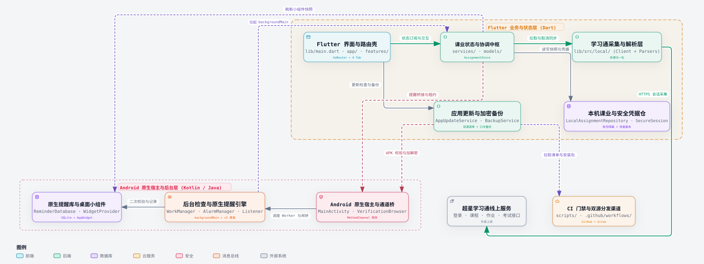
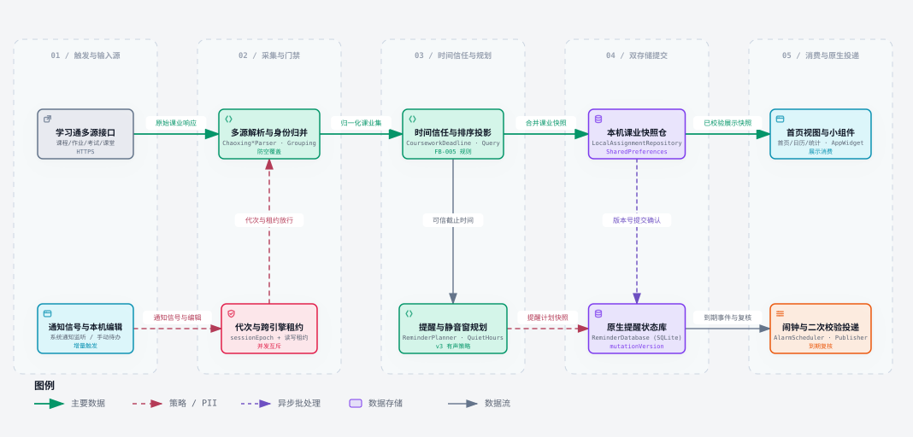
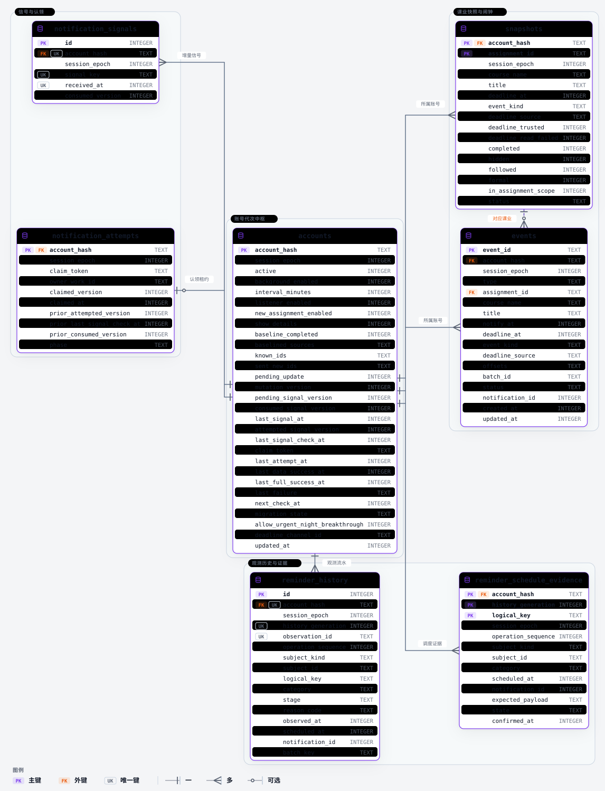
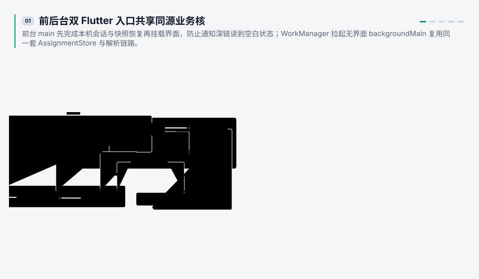

# 学习通课业手记 · 架构导航（人机共用）

- **基线 Commit**：`a33f066`（`architecture.json` 与 `sync-reminder.dataflow.json` 锚定 `a33f066`，`reminder-db.erd.json` 与 `architecture-tour.story.json` 仍锚定 `d8b7f47`。各 JSON 清单记录完整 40 位修订号。可用 `git log a33f066..HEAD --stat` 核对后续代码变更）
- **更新日期**：2026-11-27
- **适用范围**：`study_assistant-1.1.0/local_app/`（Flutter 业务层与 Android 原生宿主/后台层）、`scripts/` 与 `.github/workflows/` 门禁及分发链路；`references/xuexitong-cli/` 仅作只读上游协议参考

## 架构与数据流图入口



- 交互式架构总图：[打开交互式架构图](./architecture.html)



- 交互式同步与提醒数据流子图：[打开同步与提醒交互式数据流图](./sync-reminder.dataflow.html)



- 原生提醒 `SQLite v10`（7 表 107 列）交互式表结构图：[打开物理表结构图](./reminder-db.erd.html)（Schema 定义：[`reminder-db.erd.json`](./reminder-db.erd.json)）



- 源码联动架构漫游（39 秒，5 节拍串联前后台入口、时间信任、`mutationVersion` 与静音窗投递）：
  - Stage 交互式播放器：[打开架构漫游 Stage 播放器](./architecture-tour.stage.html)（分镜编排：[`architecture-tour.story.json`](./architecture-tour.story.json)）
  - 双主题动态 SVG：[浅色动态](./architecture-tour-light.svg) · [深色动态](./architecture-tour-dark.svg) ｜ 双主题静态首帧：[浅色静态](./architecture-tour-still-1-light.svg) · [深色静态](./architecture-tour-still-1-dark.svg)
  - 本地 1080p 60fps 演示短片：[观看架构漫游短片 (WebM)](../../scripts/demo-video/chaoxing-journal-architecture-tour.webm)

<details>
<summary>根 README.md 可直接嵌入的双主题 &lt;picture&gt; 代码片段（不改动现有 README 结构）</summary>

```markdown
<picture>
  <source media="(prefers-color-scheme: dark)" srcset="./docs/architecture/architecture-tour-dark.svg">
  <source media="(prefers-color-scheme: light)" srcset="./docs/architecture/architecture-tour-light.svg">
  
</picture>
```

> 若目标渲染环境不支持动态 SMIL/CSS 动画 SVG，可将上述 `srcset` / `src` 替换为 `./docs/architecture/architecture-tour-still-1-dark.svg` 与 `./docs/architecture/architecture-tour-still-1-light.svg`。

</details>

---

## 一、分层与模块职责表

| 分层 / 模块 | 核心目录或入口文件 | 职责边界 |
| --- | --- | --- |
| 应用入口与双引擎启动 | `study_assistant-1.1.0/local_app/lib/main.dart` | 承载前台 `main` 与后台无界面 `backgroundMain` 双入口；前台先恢复本机快照再挂载界面，后台通过 `MethodChannel` 与原生 Worker 协同执行自动检查 |
| 导航壳、主题与动效基础 | `study_assistant-1.1.0/local_app/lib/src/app/`（入口 `app_shell.dart`） | 管理 `GoRouter` 路由与 4 Tab 主壳、浅/深双主题设计系统、页面转场与预测性返回策略、Clawd 伴侣周期协调 |
| 业务页面与公共组件 | `study_assistant-1.1.0/local_app/lib/src/features/`、`features/widgets/` | 覆盖首页、日历、统计、个人页、登录与设置。页面消费领域投影状态，不直连网络或原生存储 |
| 首页交互与列表 | `features/assignment_list_screen.dart`、同层 `widgets/` 下的 `home_action_bar.dart`、`home_filter_sheet.dart`、`home_list_sections.dart`、`home_timeline_list.dart`、`journal_modal_sheet.dart` | `AssignmentListScreen` 持有页面状态与事件编排，组件分别负责操作栏与排序菜单、搜索筛选、首页分区、时间线列表。筛选面板经共享弹窗入口使用统一动效 |
| 课业协调中枢与领域模型 | `study_assistant-1.1.0/local_app/lib/src/services/assignment_store.dart`、`.../services/`、`.../models/` | `AssignmentStore` 保留公共接口、共享状态与事务协调，使用 `CourseworkDeadline` 和 `AssignmentQuery` 处理时间信任与排序投影 |
| Store · 个人状态 | `assignment_store_personal.dart`、`assignment_personal_state_coordinator.dart` | 编排个人待办、置顶、手动截止及课程设置的读写。协调器计算个人状态变更 |
| Store · 提醒 | `assignment_store_reminders.dart`、`assignment_reminder_coordinator.dart` | 编排提醒计划、历史、通知补偿和桌面小组件刷新。协调器提供提醒判断、取消结果和提醒解释 |
| Store · 同步 | `assignment_store_sync.dart`、`assignment_sync_coordinator.dart` | 编排多源同步与跨引擎同步租约。协调器计算同步选课、历史补扫、服务端退避和报告 |
| Store · 会话 | `assignment_store_session.dart`、`assignment_session_coordinator.dart` | 编排恢复、登录、账号切换、退出和备份恢复。协调器提供会话转换及恢复决策 |
| 学习通采集与多源解析层 | `study_assistant-1.1.0/local_app/lib/src/local/chaoxing_local_client.dart`、`.../local/*_parser.dart` | 封装超星学习通会话请求、取消令牌与熔断重试，将课程、作业、考试、章节、课堂任务、AI 练习与通知归一化为稳定领域模型 |
| 本机课业与安全凭据仓 | `study_assistant-1.1.0/local_app/lib/src/local/local_assignment_repository.dart`、`.../services/secure_session_store.dart` | 基于 `SharedPreferences` 维护按账号隔离的课业/待办/课程设置快照与损坏恢复副本；通过 `FlutterSecureStorage` 与 WebView 清理保管登录凭据 |
| Android 原生宿主与安全桥 | `study_assistant-1.1.0/local_app/android/app/src/main/kotlin/com/example/studyassistant/MainActivity.kt`、`.../java/com/example/studyassistant/` | 暴露安全验证 WebView、外部链接、APK 原签名/ABI 校验安装、SAF 口令加解密备份（`BackupCrypto`）、通知权限体检与音效等 `MethodChannel` |
| 后台检查与原生提醒引擎 | `study_assistant-1.1.0/local_app/android/app/src/main/kotlin/com/example/studyassistant/`（`FlutterCheckWorker.kt`、`BackgroundReminderBridge.kt`、`ReminderDatabase.kt`、`AssignmentAlarmScheduler.kt`、`AssignmentNotificationPublisher.kt`、`ChaoxingNotificationListener.kt`） | 统筹 WorkManager 后台检查、通知信号监听、跨引擎租约、SQLite 账号代次与提醒快照库、AlarmManager 精确闹钟与多版本有声通知渠道投递 |
| 桌面小组件 | `.../services/widget_snapshot_service.dart`、`.../android/.../AssignmentWidgetProvider.kt` | 同步账号认证态与待办范围快照，并在系统字号、暗黑模式或尺寸变化时渲染 Android 原生桌面小组件 |
| 应用更新与加密备份 | `.../services/app_update_service.dart`、`app_update_controller.dart`、`backup_service.dart` | 管理冷启动稳定源检查与手动双源（Gitee + GitHub）合并更新、分片下载校验，以及口令加密备份导入导出 |
| 工程门禁与发布脚本 | `scripts/`（`verify_local_gate.py`、`run_android_tests.py`、`verify_apk_and_report.py` 等）、`.github/workflows/` | 提供本地秒级定向/全量门禁、ASCII 缓存 Android 测试编译、APK 校验报告、CI 检查及 GitHub/Gitee 分发同步 |
| 只读参考实现 | `references/xuexitong-cli/` | 上游超星协议只读对照参考，不参与构建且严禁直接修改 |

---

## 二、核心链路与数据流

1. **冷启动会话恢复与导航挂载链路**
   - 前台 `main` 初始化通知服务与 `AssignmentStore` 后，**先完成本机会话与快照恢复**，再挂载 `StudyAssistantApp` 与 `AppShell`（`GoRouter` + 4 主 Tab），保证通知点击深链与首页渲染不会读取到未恢复的空白状态。
2. **学习通多源采集、时间信任裁决与排序投影链路**
   - `AssignmentStore` 驱动 `ChaoxingLocalClient` 拉取课程、作业、考试、课堂与通知等接口响应 → 经各 `Parser` 与 `AssignmentGrouping` 归并 → `CourseworkDeadline` 与 `AssignmentQuery` 裁决官方可信时间、手动截止与展示范围 → 写入按账号隔离的 `LocalAssignmentRepository` 并驱动首页/日历/统计及桌面小组件更新。
3. **前后台双引擎检查与版本化原生提醒链路**
   - 触发源包括前台同步、WorkManager 定时检查（`FlutterCheckWorker` 拉起无界面 `backgroundMain`）及系统通知监听（`ChaoxingNotificationListener` 写入增量信号）。
   - 写入前先通过 `BackgroundReminderBridge` 获取跨引擎同步/写租约并校对 `sessionEpoch`，在原生 `ReminderDatabase` 标记挂起更新后再持久化 `SharedPreferences`，随后凭读取时的 `mutationVersion` 提交提醒计划并调度 `AssignmentAlarmScheduler`；闹钟到期后经原生二次校验资格与夜间静音窗，再通过版本化有声渠道投递或延后。
4. **双源应用更新与口令加密备份链路**
   - 更新模块在冷启动仅查稳定清单，手动检查则并行合并 Gitee 清单与 GitHub Release，下载后经原生宿主校验包名、原体验签名指纹、递增版本码、SDK 与双 ABI（`arm64-v8a` / `x86_64`）再拉起安装；备份模块经原生 `BackupCrypto` 与系统文件选择器完成口令加密快照导入导出。

---

## 三、关键不变量与禁区

1. **同步失败与未知时间语义底线**：读取失败严禁当作“零作业”覆写本机快照；截止时间未知严禁推断成“无截止”；本机隐藏/本地完成不得伪写成学习通线上已提交；课程归属必须区分课程与班级双维身份。
2. **时间信任隔离与 `FB-005` 首页排序不变量**：仅用于展示的考试时间范围绝不写回可信时间、日历、提醒或备份；一旦存在官方可信截止时间即自动接管，防止过期手动截止时间复活；普通首页确认逾期在双向时间排序中始终置底，调整排序逻辑必须保留 `FB-005` 回归保障。
3. **跨引擎双存储一致性和账号代次隔离**：`SharedPreferences` 与 Android `SQLite`（`ReminderDatabase`）分属不同存储事务，必须经同步租约、写租约、`sessionEpoch`、`pendingUpdate` 与 `mutationVersion` 串行提交并拒绝过期或跨账号脏写；停止后台任务时必须立即取消网络请求并拒绝迟到落盘。
4. **Android 通知渠道与迁移事务边界**：Android 8.0+ 已注册通知渠道严禁覆写重建以免冲掉用户系统设置；新装与升级按版本化有声渠道（`v3`）区分管理；旧插件作业提醒先完成分类迁移后方可由新投递器接管；每日摘要与个人日程维持既定补偿式通知事务，不得简化为全量清空重建。
5. **安装身份、隐私与中文路径构建禁区**：保持 `com.example.studyassistant.journal` 包名与既有签名证书连续性，Release APK 必须包含 `arm64-v8a` 与 `x86_64` 双 ABI 且排除 `armeabi-v7a`；严禁提交真实账号响应、Cookie、密钥、`.apk` 或私有截图；仓库路径含中文时禁止在本地裸跑 `flutter analyze`，统一使用 `scripts/verify_local_gate.py` 与 `scripts/run_android_tests.py --local-fast`。

---

## 四、常见问题定位入口

| 改动或排查场景 | 优先查看目录 / 入口文件 |
| --- | --- |
| 首页筛选、分组、置顶、`FB-005` 排序与卡片展示 | `lib/src/features/assignment_list_screen.dart` 管理页面状态。操作栏和排序菜单看 `widgets/home_action_bar.dart`，搜索和筛选看 `widgets/home_filter_sheet.dart`，同步状态与分组标题看 `widgets/home_list_sections.dart`，时间线与卡片看 `widgets/home_timeline_list.dart`。排序与分组规则看 `lib/src/services/assignment_query.dart`、`assignment_grouping.dart` |
| 共享底部弹窗的进出场或减弱动态 | `lib/src/features/widgets/journal_modal_sheet.dart`、`lib/src/app/journal_motion.dart` |
| 个人待办、置顶、手动截止或课程设置写入 | `lib/src/services/assignment_store_personal.dart`、`assignment_personal_state_coordinator.dart` |
| 课业同步、自动检查、选课范围或退避 | `lib/src/services/assignment_store_sync.dart`、`assignment_sync_coordinator.dart` |
| 学习通登录、会话失效或账号切换 | `lib/src/services/assignment_store_session.dart`、`assignment_session_coordinator.dart`、`lib/src/local/chaoxing_local_client.dart` |
| 验证码或某类任务解析漏抓 | `lib/src/local/chaoxing_local_client.dart`、`lib/src/local/chaoxing_*_parser.dart`、`references/xuexitong-cli/` |
| 截止时间显示、改期冲突、手动截止或考试范围 | `lib/src/services/coursework_deadline.dart`、`exam_wall_time.dart`、`exam_schedule_presentation.dart` |
| 后台检查调度、通知漏响/误响、静音时段或历史记录 | `lib/src/services/assignment_store_reminders.dart`、`assignment_reminder_coordinator.dart`、`background_reminder_gateway.dart`、`local_notification_service.dart`、`android/.../FlutterCheckWorker.kt`、`ReminderDatabase.kt`、`AssignmentNotificationPublisher.kt` |
| 界面主题配色、转场动画、悬浮顶栏或 Clawd 像素伙伴 | `lib/src/app/app_shell.dart`、`journal.dart`、`lib/src/services/clawd_companion_controller.dart`、`lib/src/features/widgets/` |
| 检查更新、双源清单回退或 APK 校验安装 | `lib/src/services/app_update_service.dart`、`app_update_controller.dart`、`android/.../UpdateApkPolicy.java`、`MainActivity.kt` |
| 加密备份与个人附件/工作区 | `lib/src/services/backup_service.dart`、`android/.../BackupCrypto.java`、`BackupBridge.kt`、`PersonalFileBridge.kt` |
| 桌面小组件刷新异常或深色适配 | `lib/src/services/widget_snapshot_service.dart`、`android/.../AssignmentWidgetProvider.kt` |
| 本地快检、Android 测试与打包发布校验 | `scripts/verify_local_gate.py`、`scripts/run_android_tests.py`、`scripts/verify_apk_and_report.py`、`.github/workflows/` |

---

## 五、AI 使用与防脱节维护规范

- **上下文纪律**：AI 日常开发与排查**只读 `ARCHITECTURE.md`**，**禁止读取 `architecture.html`、`sync-reminder.dataflow.html`、`reminder-db.erd.html`、`architecture-tour.stage.html` 以及 `.archify/**/*.html`**（内含完整前端渲染代码，白耗 Token）；`architecture.json`、`sync-reminder.dataflow.json`、`reminder-db.erd.json` 与 `architecture-tour.story.json` 仅在刷新架构图时读写。
- **信任边界**：本文档是**定位导航，不是源码真源**；改代码前必须读盘核实实际源码。若发现图/文与最新代码冲突，**以代码为准**并在回复中提示需要刷新架构文档。
- **更新节奏（防过期 & 防过度维护）**：
  - **不更新**：单文件修 Bug、局部实现微调、纯样式/文案改动等小修小补，**不要**反复修改架构图。
  - **必须同步更新**：每个大版本收口、跨模块重构、新增/拆分/下线模块、变更核心数据流/状态机/底层不变量时，在收尾阶段由 AI 对照最新代码，基于现有 `docs/architecture/*.json` 做增量修改 → 重跑 `finalize` 与 `export-svg`（必要时同步 `story svg` / `story stage`）→ 覆盖更新 `ARCHITECTURE.md` 及其顶部基线 Commit。
  - **大版本汇总 PR 架构变更对比包**：从 `dev` 向 `main` 提汇总 PR 前，可基于基线对比生成可视化变更包（输出目录需指向非云盘暂存路径再拷回）：
    ```bash
    node D:/codex/项目-skills技能仓库/archify/archify/bin/archify.mjs pr preflight --repo-root . --base origin/main --head HEAD --init <非云盘目录> --json
    node D:/codex/项目-skills技能仓库/archify/archify/bin/archify.mjs pr build <pr-pack.manifest.json> --out-dir <非云盘输出目录> --repo-root . --json
    ```
  - **环境备注**：若本地工作区正由 `GoogleDriveFS` 同步（`.tmp.driveupload/` 会使新建文件变成 `nlink=2`），在仓库内直接写入产物会触发 Archify 单硬链接安全拒写；可将 `--repo-root .` 指向本仓库、将 CLI 输出路径暂时指向非云盘暂存目录跑通门禁后再用 Node 拷回 `docs/architecture/`（或先暂停云盘同步后直接生成）。
