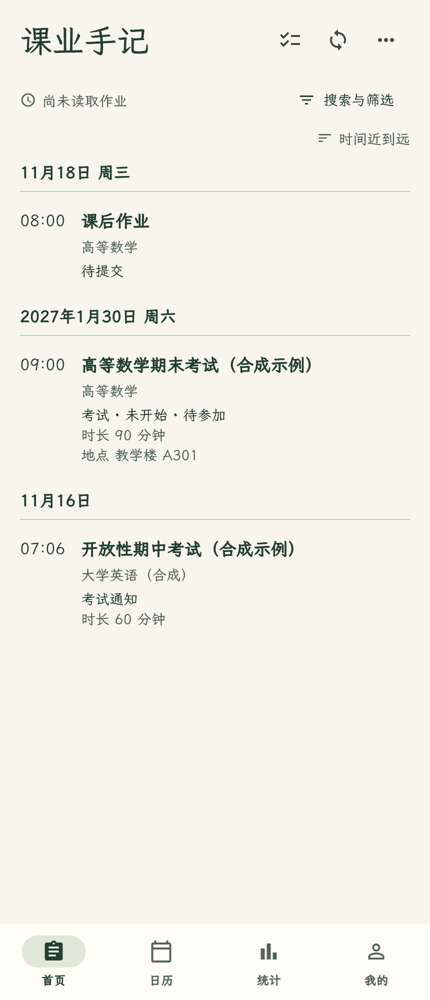

# 1.8.03 考试时间轴验收与发布记录

## 发布对象

- 版本 1.8.03+70；功能提交 `5e167a8719ea08cf86d8e61c693c77c4a13821b5` 经 [PR #35](https://github.com/arrry-07/chaoxing-journal/pull/35) 合入应用源码 `9f57d8a3ff60a463779987d92a33d27a67d0cb3d`。
- annotated Tag `v1.8.03`，object `8029551549eb11382ddb1fef1e65930213f41c22`，指向上述源码。后续文档提交不移动 Tag、不替换 APK。
- [GitHub Release](https://github.com/arrry-07/chaoxing-journal/releases/tag/v1.8.03) id `446608223`，北京时间 2026-11-16 12:34:04 公开，非预发布并设为 latest。
- [APK](https://github.com/arrry-07/chaoxing-journal/releases/download/v1.8.03/chaoxing-journal-1.8.03.apk) 59,442,050 字节，asset `753448807`；[SHA256SUMS.txt](https://github.com/arrry-07/chaoxing-journal/releases/download/v1.8.03/SHA256SUMS.txt) asset `753448822`。
- SHA-256：`0e43d8a0503b0f09b6243c6b0c3862bf774a8834f9fb8138ea6546dba2521825`。包名 `com.example.studyassistant.journal`、70/1.8.03、min26/target36、ARM64/x86_64、非 debuggable、原 v2 证书、ZIP CRC 和 16 KiB 对齐均通过。

## 行为结果

- 考试列表使用与作业一致的日期标题、分隔线和左侧开考时刻，右侧显示考试名称、课程、状态及已知时长/地点。完整起止时间在详情中查看，读屏语义仍包含完整区间。
- 可信开始时间优先；只有同一课程、班级和考试身份关联的唯一通知区间可提供展示时刻。未注明年份时只显示月日，不推算年份或星期；只知道结束时间、通知冲突或身份不一致时不生成开考时间栏。
- 通知原文展示对象只保存字符串，不写入 `startAt/endAt` 或信任字段，不参与排序、日历、提醒和自动结束。1.8.02 中已实现的通知时间展示、今日计划轻入口和筛选持久化一并进入本版。
- 缺年份或通知时间冲突时，卡片读屏会同时朗读完整时间与核对说明。整组隐藏部分失败后仍保留原页面重试入口；通知换行、重复冲突字段和零秒精度边界已有回归。

## 验证证据

| 范围 | 结果 |
| --- | --- |
| 本地定向回归 | 首页、考试卡片、解析、版本及混排相关 180 项通过；审查修正后的考试卡片 11 项通过；`lib`/`test` 静态分析无问题 |
| 最终 PR/push | [43800780975](https://github.com/arrry-07/chaoxing-journal/actions/runs/43800780975)、[43800774542](https://github.com/arrry-07/chaoxing-journal/actions/runs/43800774542)：1219 通过、1 项可选基准跳过，双时区各 49 项，原生/分析/双 ABI 通过 |
| 应用 main/Tag | [43801650831](https://github.com/arrry-07/chaoxing-journal/actions/runs/43801650831)、[43803621566](https://github.com/arrry-07/chaoxing-journal/actions/runs/43803621566)：同一完整矩阵通过，均绑定 `9f57d8a3` |
| 构建与晋升 | Flutter 3.44.9 / Dart 3.12.2、JDK 17、SDK 36；入口 `lib/main.dart`、锁依赖、原签名、双 ABI。r2 导出的 364 项规范应用输入与最终 main 的 Git archive 字节逐一相同，签名和构建参数一致，生成本机版本属性为 70/1.8.03，无提交号派生元数据 |
| 下载校验 | 草稿认证完整回下载和公开匿名完整回下载均匹配大小、摘要、校验文件、包信息、原签名、ZIP 及对齐；匿名请求不含认证或 Cookie |

GitHub 云端自动代码审查因 Codex 审查额度用尽而未能完成，未产生可关闭的审查线程，因此不将云端代码审查列为通过。本地独立只读审查发现了缺年/冲突时间缺少读屏核对说明的问题，已补充实现和回归后通过。

## MuMu 实际验收

- 原“学习通”实例使用 `adb install -r` 覆盖，未卸载或清数据；首次安装时间 `2026-11-04 19:05:10` 保留，设备回拉 `base.apk` 与正式文件同哈希。
- 真实“开放性期中考试”列表显示 `11月16日` 标题、左侧 `07:06` 与考试名称对齐，未显示完整区间堆叠、未知分组或横杠占位；详情保留 `11-16 07:06:00 至 11-30 07:06:31` 和 60 分钟，核对说明只出现一次。
- 原作业卡片样式、今日计划轻入口、筛选取消及 force-stop 重启后的配置保留通过。14 条记录身份/状态、7 门课程、隐藏 0 条、个人安排及笔记均保留，没有记录字段变化。
- 发布后实际点击“检查更新”显示“当前已是最新版本”，当前版本 1.8.03（70）。该检查未触发下载或安装。
- 本版没有重新执行日历完整交互流程；相关源码在 1.8.03 的定向/CI 范围内，但不将 1.8.02 的设备日历证据冒充为本版实际运行结果。

## 分发与未覆盖

- [Gitee index 43804878614](https://github.com/arrry-07/chaoxing-journal/actions/runs/43804878614) 成功，实际结果为 `mode=index, stable=1.8.0, manual=1.8.03, deleted=[]`。
- 匿名读取 Gitee manual 为 1.8.03+70，大小/摘要与正式 APK 一致，`apkUrl` 指向 GitHub 同版本包且无 `backupApkUrl`；stable 保持 1.8.0+67。Gitee APK 镜像仍为批量点 1.7.52+59，本版未镜像或重下历史包。
- 现有部分课程考试及账号考试来源仍可能报告结构失败；独立课程群云历史未启用，不能宣称全来源完整。历史考试时间补全、增量/并发优化和完整成功性能对照仍在后期计划。
- 实体手机、Doze、TalkBack、API 31 和锁屏真实通知链路本轮未重验；合成测试覆盖窄屏、两倍字体、冲突/仅结束/无年份等失败边界。

原始通知、设备截图、XML、APK 回拉、完整 CI 日志和构建证据仅保存在忽略目录 `artifacts/2026-11-16/exam-timeline-1.8.03`、应用 `build` 及 `D:/campus-tools/build-work/release-1.8.03-*`，不进入 Git。1.8.02 的 Tag 与草稿 Release 保留，不覆盖或公开为正式版本。
