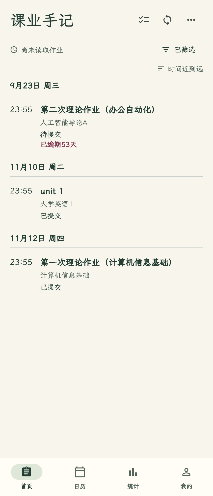

# 1.8.04 首页排序与筛选验收与发布记录

## 发布对象

- 版本 1.8.04+71；功能提交 `3a712120c9c5b87acac72c91dd38d9835d0c474b` 经 [PR #36](https://github.com/arrry-07/chaoxing-journal/pull/36) 合入应用源码 `a4a4b01cbabad01f72e445de0c05f18d78af46b0`。
- annotated Tag `v1.8.04`，object `51cbf84b8bf20f02908a73b3bf3061a34966b566`，指向上述源码。后续文档提交不移动 Tag、不替换 APK。
- [GitHub Release](https://github.com/arrry-07/chaoxing-journal/releases/tag/v1.8.04) id `446717018`，北京时间 2026-11-16 15:26:28 公开，非预发布并设为 latest。
- [APK](https://github.com/arrry-07/chaoxing-journal/releases/download/v1.8.04/chaoxing-journal-1.8.04.apk) 59,442,050 字节，asset `753885064`；[SHA256SUMS.txt](https://github.com/arrry-07/chaoxing-journal/releases/download/v1.8.04/SHA256SUMS.txt) asset `753885062`。
- SHA-256：`56145a93b625fc2326f920200720bd7acd2ff4dc6b177b92a53f9572729e1d45`。包名 `com.example.studyassistant.journal`、1.8.04/71、min26/target36、ARM64/x86_64、非 debuggable、原 v2 证书、ZIP CRC 和 16 KiB 对齐均通过。

## 行为结果

- “时间近到远”和“时间远到近”统一按考试开考时间与作业截止时间混排；未知时间在两种方向中都置后。可信开考时间优先，其次只采用同一课程、班级和考试身份关联的唯一通知区间。
- 通知缺年份时按当前北京时间年份生成只读展示投影，仅用于时间排序和期限筛选。投影不写回 `startAt/endAt` 或信任字段，不参与日历、提醒和自动结束，也不改变备份 schema。
- “未逾期”对唯一通知时间窗口使用同一投影；考试窗口尚未结束且个人未完成时保留，官方结束/取消或明确完成后排除，无法形成唯一开考时间的记录仍只在“全部”中查看。
- 搜索、类型、课程或期限筛选生效时覆盖完整可见本地目录。类型“作业”包含已提交记录；期限“未逾期/已逾期”仍排除已完成记录。清除筛选后首页恢复当前待办。
- 课程下拉从完整目录生成，只有历史记录的课程仍可选；多条不同考试通知的起止或时长冲突时不借用时间。现有账号隔离、关注课程、隐藏、考试合并、提醒、日历和备份语义保持不变。

## 验证证据

| 范围 | 结果 |
| --- | --- |
| 本地最终集成 | 1231 通过、1 项可选存储基准跳过；`lib`/`test` 静态分析无问题。真实缓存回放确认默认“作业”1 条、显式筛选“作业”3 条、`notExpiredRecords=3`、`notExpiredExam=1`，考试进入后续日期项之前 |
| PR / push | [43817476851](https://github.com/arrry-07/chaoxing-journal/actions/runs/43817476851)、[43817469391](https://github.com/arrry-07/chaoxing-journal/actions/runs/43817469391)：1231 通过、1 项可选基准跳过，双时区各 49 项，原生/分析/双 ABI 通过 |
| 应用 main / Tag | [43820730477](https://github.com/arrry-07/chaoxing-journal/actions/runs/43820730477)、[43821979442](https://github.com/arrry-07/chaoxing-journal/actions/runs/43821979442)：同一完整矩阵通过，分别绑定 main 与 annotated Tag |
| 构建与晋升 | Flutter 3.44.9 / Dart 3.12.2、JDK 17、SDK 36；入口 `lib/main.dart`、锁依赖、原签名和双 ABI。366 项规范应用输入与最终 main 的 Git archive 逐字节一致，生成版本属性为 71/1.8.04，无提交号派生元数据 |
| 下载校验 | 草稿认证完整回下载与公开匿名完整回下载均匹配大小、摘要、校验文件、包信息、原签名、ZIP 和对齐；匿名请求不携带认证或 Cookie |

本地独立审查发现并修正了两项问题：课程下拉曾只从当前待办生成，导致仅含历史记录的课程不可选；不同通知的时长冲突曾可能参与展示结束时间。对应纯历史课程与多通知冲突回归已补充。GitHub 云端自动代码审查因 Codex 审查额度未完成，不列作通过。

## MuMu 实际验收

- 原“学习通”实例使用 `adb install -r` 覆盖，未卸载或清数据；首次安装时间 `2026-11-04 19:05:10` 保留，设备回拉 `base.apk` 与正式文件同哈希。
- “时间近到远”实测顺序为 9/23 作业、11/16 07:06 开放性期中考试、12/2 任务、2027/1/30 任务；考试不再因为来源类型被放到末尾。
- “未逾期”保留当前考试并排除已过期待提交作业；强制停止并重启后筛选仍保留。
- 类型“作业”显示三份真实记录，其中 1 条待提交、2 条已提交；“时间远到近”顺序与筛选偏好在重启后保持，最终已恢复时间近到远并清空筛选。
- 14 条原记录身份/状态、7 门课程、隐藏 0 条、个人计划与笔记均保留。考试详情继续显示秒级起止、60 分钟和缺年份核对说明。
- 发布后实际点击“检查更新”显示“当前已是最新版本”，当前版本 1.8.04（71）；未触发下载或安装。

## 分发与未覆盖

- [Gitee index 43823879212](https://github.com/arrry-07/chaoxing-journal/actions/runs/43823879212) 成功，实际结果为 `mode=index, stable=1.8.0, manual=1.8.04, deleted=[]`。日志中早期 `1.7.55` 行是离线同步器测试输出，不代表线上状态。
- 匿名读取 Gitee manual 为 1.8.04+71，大小/摘要与正式 APK 一致，`apkUrl` 指向 GitHub 同版本包且无 `backupApkUrl`；stable 保持 1.8.0+67。Gitee APK 镜像仍为批量点 1.7.52+59，本版未镜像或重下历史包。
- 现有部分课程考试和账号考试来源仍可能报告结构失败；独立课程群云历史未启用，不能宣称全来源完整。日历设备端完整交互流程本轮未重跑，但相关信任、提醒、自动结束和备份字段未改。
- 实体手机、Doze、TalkBack、API 31 和锁屏真实通知链路本轮未重验；合成回归覆盖无年份、闰日、冲突、仅结束、双向排序、窄屏大字和当前时间窗口。

原始通知、真实设备截图/XML、APK 回拉、完整 CI 日志和构建证据仅保存在忽略目录 `artifacts/2026-11-16/home-query-1.8.04`、应用 `build` 及 `D:/campus-tools/build-work/release-1.8.04-*`，不进入 Git。仓库中的两张图均为合成样例，不含真实账号资料。
