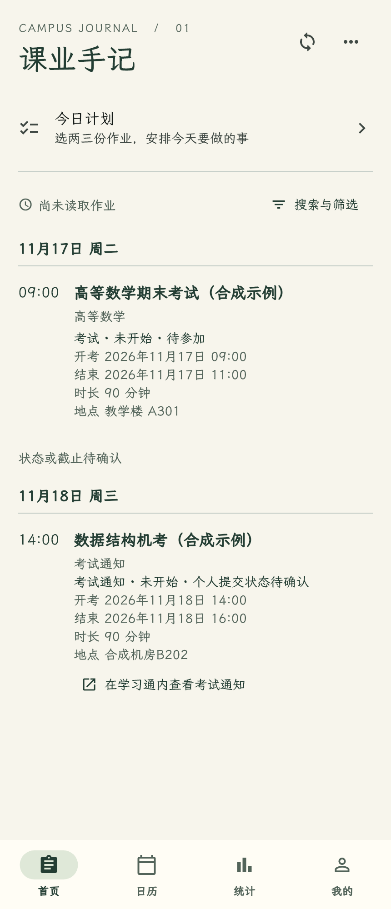
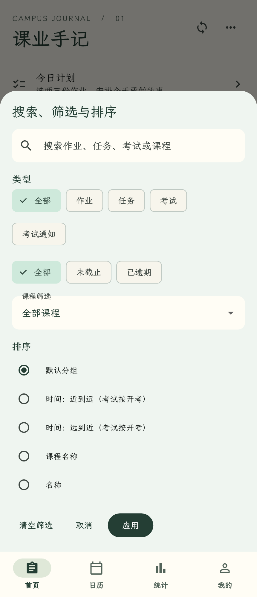

# 1.8.0 AI实践与考试验收与发布记录

1.8.0+67 已正式发布。功能提交 `800c52670fc6139912d049bbc75813357395a175` 经 [PR #32](https://github.com/arrry-07/chaoxing-journal/pull/32) 合入 main `c49ebf314e0c023f321c0eb8e4f2a4c57d5ae201`；annotated Tag `v1.8.0`（object `532a37e373bf1e8d4263b240cec99e72d9479305`）指向该 main。发布后的文档提交不移动 Tag，不改变应用输入或已发布 APK。

## 最终行为与审查

- AI实践77通过官方个人接口读取，分别验证课程/班级、活动、发布关联及当前账号，保留正式作业、35个人任务和42随堂练习。
- 课程手机/PC考试列表与账号考试安排分别读取；考试结束和个人交卷分开。首页统一课业并按类型筛选，考试按可信开考日进入日历，开考提醒沿用现有开关和提前量，首次来源回填静默。
- 考试通知读取正文/RTF及已验证卡片的真实名称、起止、时长和提供的地点。仅完整课程/班级/考试身份一致才关联当前日程和个人状态；缺年份需要同一考试的完整、匹配且唯一的起止证据，同名不同身份不能借用。
- 只谈考试纪律等普通通知过滤。正文、RTF及卡片中的入考访问参数不落盘；产品入口仅打开官方列表或收件箱，不自动开考、读取试题、答案或提交。
- 列表中的显式隐藏开考验证码弹窗不再误判为可见验证；真实可见挑战、外部验证跳转及歧义DOM仍保留验证要求。
- 按页保留已成功数据，来源失败保留其他来源结果；时间补查失败保留历史起止并撤销信任。备份schema5兼容1–4及缺少可选关联字段的候选备份，恢复后重新在线核对；提醒SQLite升至3。
- 独立审查发现的成功来源丢弃、分页丢页、历史时间清空、访问参数落盘及单端年份拼接均已补有效回归并修复、复核关闭。

界面沿用原视觉，增加首页名称、类型筛选、考试信息及必要来源状态文字。合成渲染图不含真实账号数据：

## 验证与证据绑定

| 对象 | 已确认结果 |
| --- | --- |
| 本地最终集成 | `local_app/build/exam-notice-integrated-final.log`：201通过；lib/test静态分析无问题，变更格式及版本一致性通过 |
| PR CI | [43750103838](https://github.com/arrry-07/chaoxing-journal/actions/runs/43750103838)：1113通过/1项可选容量基准跳过，上海/洛杉矶各49项，原生JVM、Gradle单测/仪器编译/lint、分析及双ABI构建通过 |
| main CI | [43751194090](https://github.com/arrry-07/chaoxing-journal/actions/runs/43751194090)：同矩阵通过，绑定main c49ebf3 |
| Tag CI | [43752275738](https://github.com/arrry-07/chaoxing-journal/actions/runs/43752275738)：同矩阵通过，绑定v1.8.0/c49ebf3 |
| 原生设备仪器 | 隔离 `.examqa` 包21项通过，包含SQLite升级、考试事件持久化、取消及混合聚合通知。原生源/测试/配置与最终源码一致，未因Dart解析改动重复运行 |
| 真实私有回放 | 7课1考试+6空课、2份通知的名称/完整起止/60分钟时长/个人状态一致；完整PC页面脱敏结构通过隐藏弹窗识别，样本不进入Git或构建 |
| 构建晋升 | 原签名Release从800c526干净ASCII导出；350个规范Git应用输入与最终main逐一哈希相同，入口、锁依赖、签名配置和参数相同，无提交号派生元数据，完整候选按证据晋升而不重建 |

工具链为Flutter 3.44.9 / Dart 3.12.2、JDK17、SDK36/NDK28.2。构建入口`lib/main.dart`，`--target-platform android-arm64,android-x64`，使用锁定依赖及原体验签名。旧候选r1/r2均被真实验收阻断且未公开，不作为本次通过证明。

私有日志、回放和结构化证据在Git忽略目录 `artifacts/2026-11-15/exam-investigation/`、应用`build/`及 `C:/campus-tools/build-work/release-1.8.0-r3/`；最终文件在 `C:/campus-tools/build-work/release-1.8.0-final/`。真实响应、账号标识、访问参数、截图和签名配置不提交、不外发，不纳入导出。

## 正式APK与MuMu

- APK：`chaoxing-journal-1.8.0.apk`，59,310,902字节。
- SHA-256：`5af830a57dccb419b731475ea24497270b3a3b7010ed85205f5c0c93feff504b`。
- 身份：`com.example.studyassistant.journal`，1.8.0/67，min26/target36，ARM64/x86_64，非debuggable，原v2体验证书（指纹前缀d36a5715），ZIP CRC与16KiB对齐通过。
- 原MuMu数据保留覆盖安装，首次安装时间仍为设备显示的2026-11-04 19:05:10；设备base.apk回拉哈希与正式文件一致。登录、原9条课业、偏好语义、个人计划及笔记保留；新增的筛选type=all不改变原查询/课程/期限/排序。
- 实际完整刷新7课程/12记录：3正式作业、1任务、3练习、2AI实践、1考试及2通知；9submitted/3pending，已启用来源成功，issues=[]。
- 真实考试与2份通知均显示实际名称、可信完整起止和60分钟时长；2通知按明确身份关联同一已完成课程考试，完整信息保留在本地记录，首页只列未完成课业。
- 当前官方通知和考试页面没有提供实体考场。界面明确“通知未提供实体考场”或“官方考试页未提供实体考场”，不虚构教室；已核对真实详情字段、类型控件及调起官方WebView入口。
- uiautomator在Activity切换时出现139，页面稳定后自身详情快照完成；官方页面内容快照不作为通过证据。官方入口已确认调起官方App，未进入试题或提交。
- 发布后MuMu手动“检查更新”实际显示“当前已是最新版本”。覆盖验收是ADB同签名安装，不冒称旧客户端已完成应用内在线升级。

## GitHub发布与分发

[GitHub Release v1.8.0](https://github.com/arrry-07/chaoxing-journal/releases/tag/v1.8.0)（id 446312101）已公开、非预发布并设为latest；公开时间为北京时间2026-11-16 03:41:54。APK资产id 752117536，校验文件id 752117535，GitHub digest与正式文件一致。

草稿认证完整回下载及公开匿名完整回下载的APK/校验文件均已匹配，包信息、原签名、ZIP和16KiB对齐通过。匿名请求不携带账号认证或Cookie。历史Tag/APK/Release未更换。

- [下载安装包](https://github.com/arrry-07/chaoxing-journal/releases/download/v1.8.0/chaoxing-journal-1.8.0.apk)
- [SHA256SUMS.txt](https://github.com/arrry-07/chaoxing-journal/releases/download/v1.8.0/SHA256SUMS.txt)
- Gitee自动[index 43753863996](https://github.com/arrry-07/chaoxing-journal/actions/runs/43753863996)成功，`mode=index`，`deleted=[]`，APK工具安装步骤跳过。
- 公开[manual](https://raw.giteeusercontent.com/arrry-07/chaoxing-journal-updates/raw/master/update-manual.json)和[stable](https://raw.giteeusercontent.com/arrry-07/chaoxing-journal-updates/raw/master/update-stable.json)实测均为1.8.0+67，大小/摘要一致、apkUrl指向GitHub同版本正式包、无backupApkUrl。stable因主/次版本提升而前进。
- 本版没有上传Gitee APK。公开Release元数据仍显示APK批量镜像点v1.7.52（59）；本轮未重新下载该历史镜像包，不将小索引同步写成新APK镜像完成。

PR前、合并前、Tag/资产上传前与公开前的对象和证据检查均通过；发布后访问、匿名回下载、小索引及手动更新检查通过。本记录及工程状态属于发布后文档收口，应用源码仍绑定c49ebf3/v1.8.0。

## 验证范围限制

- 独立课程群云历史仍为notEnabled，不能声称所有课业来源均已覆盖。
- 当前账号考试安排表真实样本为空，非空未知结构会明确报告失败，不猜测身份或当作空列表。
- 真实考试样本为已完成；未开始/进行中/改期/取消/跨天及非空翻页边界以合成回归覆盖，没有冒称真实场景均已发生。
- 未提供的实体考场仍是来源缺项；不会根据课程教室、标题或通知发送时间推断地点和开考时间。
- 实体手机后台/Doze、TalkBack、API31、锁屏真实通知链路本轮未重新验证。以上未覆盖项不计为通过。
